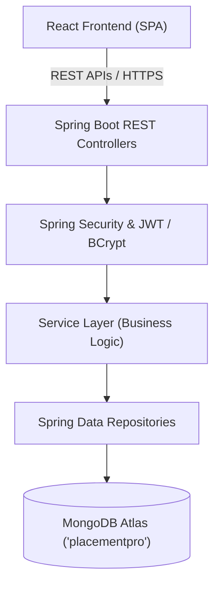

# PlacementPro – Placement Preparation & Coding Practice Platform


> A full-stack web application for coding practice, placement preparation, progress tracking, mock interviews, and administrative oversight.

---

## 🎓 Capstone Project Submission Details

- **Academic Session:** 2026 Academic Project Documentation
- **Section:** Section 12 (24ML-12B)
- **Group:** Group B
- **Project Authors:**
  - **Sejal Verma** (UID: `24BAI70953`)
  - **Khusbu Kumari Kewat** (UID: `24BAI71022`)
  - **Shivam Yadav** (UID: `25BCS12535` / Account: `academyxshivam@gmail.com`)

### 📌 Submission Links

| Deliverable | Verified Access Link |
| :--- | :--- |
| 📊 **Capstone Project PPT (Drive)** | [View Presentation on Google Drive](https://docs.google.com/presentation/d/1kjYMKApl4AdkL_L4Irge-DAxEdv4hDQL/view?usp=sharing) |
| 📑 **Project Report Submission (PDF Drive)** | [Download / View PDF on Google Drive](https://drive.google.com/file/d/1mPQVtDQfgXm-AWtXi9PpQUHfJ7X2Qtxe/view?usp=sharing) |
| 💻 **GitHub Repository** | [https://github.com/codexshivam/placementpro](https://github.com/codexshivam/placementpro) |
| 🚀 **Live Project Link (GitHub Pages)** | [https://codexshivam.github.io/placementpro/](https://codexshivam.github.io/placementpro/) |

---

## 🌟 Key Platform Modules & Features

1. **Student Dashboard:** Metrics tracking (problems solved, streak counter, mock interview rating, and credit balance).
2. **Coding Problem Catalogue:** 15 curated foundational interview problems categorized across Easy, Medium, and Hard, with topic tags (Arrays, Hash Table, Stack, Trees, Dynamic Programming, Graphs).
3. **Problem Detail Workspace & Code Studio:** Dedicated coding environment with multi-language starter templates (Java 24, Python 3.12, JavaScript, C++ 20, C 17), independent code buffers, and simulated execution against test cases.
4. **Company Explorer:** In-depth placement prep guides for 8 premier tech companies: Google, Microsoft, Amazon, Meta, Adobe, Uber, TCS (Digital), and Infosys (DSE/SP).
5. **30-Day Preparation Roadmap / Study Plan:** Interactive checklist tracking placement preparation milestones with progress persistence.
6. **AI Mock Interview & Resume Analyzer:**
   - Domain-specific technical questions (DSA, Java & Spring Boot, System Design, Behavioral STAR queries).
   - ATS resume scanner providing feedback and compatibility scoring.
7. **Competitive Leaderboard:** Real-time student ranking based on practice consistency, problems solved, and total credits.
8. **Rewards & Credit Store:** 8 redeemable items (1-on-1 mock interviews, resume reviews, Amazon vouchers, FAANG blueprints).
9. **Administrative & Diagnostics Panel:** Role-protected controls, MongoDB Atlas status monitoring, and RBAC enforcement.

---

## 🏗️ Architecture & Technology Stack



- **Frontend:** React.js, React Router, JavaScript (ES6+), Prism syntax highlighting, responsive CSS.
- **Backend:** Java 24, Spring Boot 3.2.5, Spring Data MongoDB, Maven.
- **Database:** MongoDB Atlas (Cloud Cluster, Database: `placementpro`).
- **Security:** JWT authentication, BCrypt password hashing, Role-Based Access Control (RBAC).

---

## 🚀 Local Development Setup

### Backend Setup
```bash
cd backend-springboot
mvn clean spring-boot:run
```
The backend server runs on `http://localhost:8080`.

### Frontend Setup
```bash
cd frontend
npm install
npm start
```
The frontend application runs on `http://localhost:3000`.

---

## 📄 License & Academic Attribution
Developed for Capstone Project Evaluation 2026. All rights reserved.
